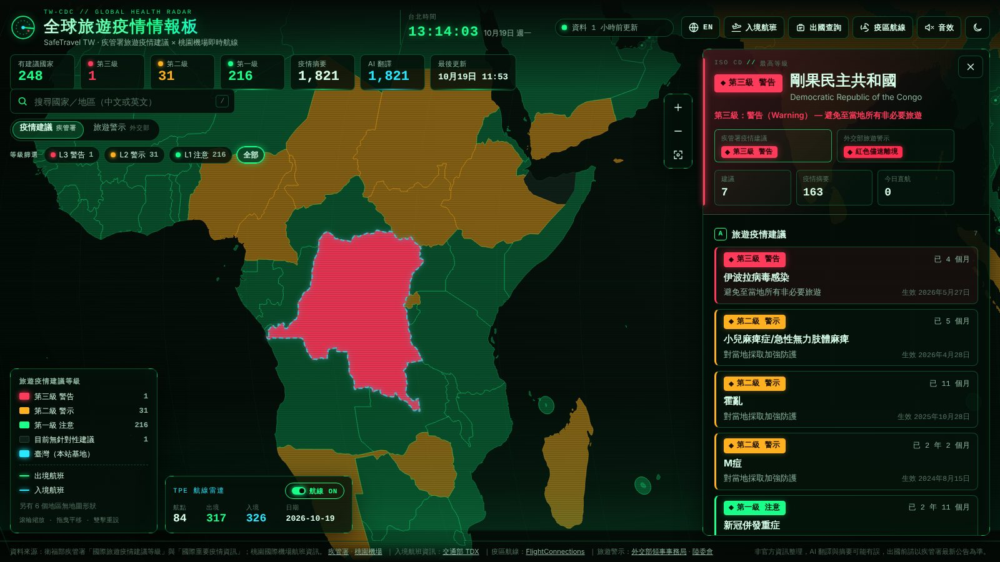
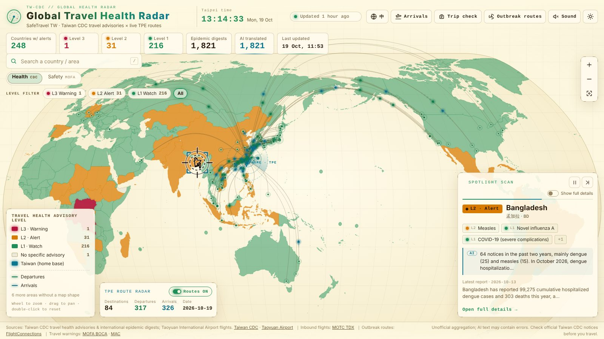
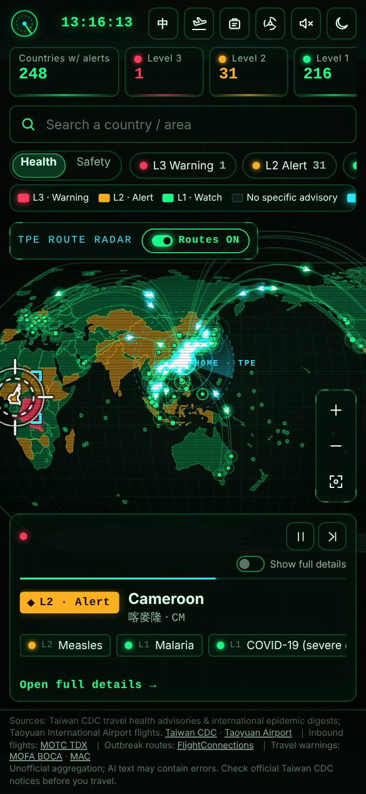
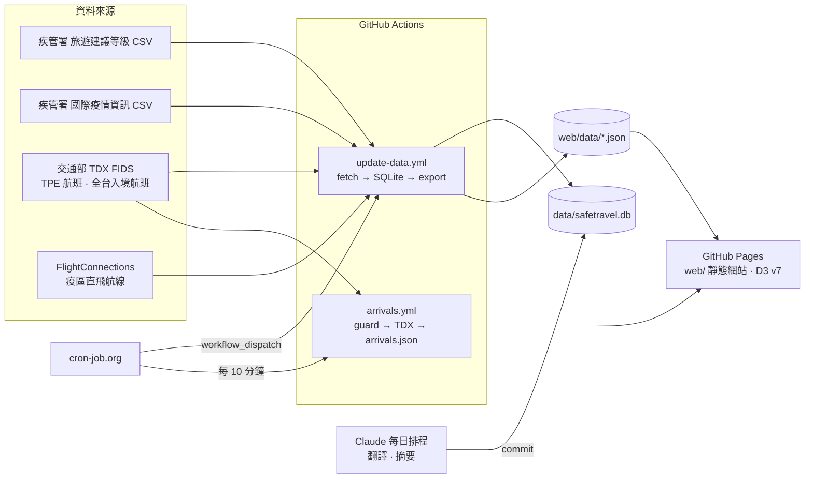

# SafeTravel TW · 全球旅遊疫情情報板

**線上網站 / Live site：** <https://ancientsky.github.io/safetravel/>


| 國家面板 / Country panel | 入境航班看板 / Inbound flights board |
|---|---|
|  |  |
| **疫區航線監測 / Outbreak route watch** | **淺色主題（英文）/ Light theme (English)** |
|  |  |

| 直式牆面螢幕 / Portrait wall screen | 手機 / Phone |
|---|---|
|  |  |

---

## 繁體中文

### 這是什麼

SafeTravel TW 是一個部署在 GitHub Pages 的靜態網站，把臺灣疾病管制署（疾管署）的「國際旅遊疫情建議等級」與「國際重要疫情資訊」，結合交通部 TDX 的即時航班資料，整理成一張可互動的世界地圖：

- **旅遊疫情建議地圖**：依各國最高建議等級上色（第一級注意、第二級警示、第三級警告），已解除的建議不顯示。
- **國家面板**：點選國家可看到所有有效建議（同疾病的多個省分會合併顯示）、AI 兩年疫情總覽，以及近兩年疫情時間軸（中英對照，可展開全文、連回疾管署原文）。
- **焦點輪播**：每 15 秒自動介紹一個國家；可切換「查看完整資訊」自動開啟國家面板，並以閱讀速度自動捲動。
- **桃園機場航線雷達**：以當日桃園機場（TPE）出入境航點畫出動態航線。
- **入境航班看板**（給機場檢疫站）：目前時間前後 60 分鐘內抵達的國際客機，可依機場與檢疫站（桃園 A、B＝第一航廈，C、D＝第二航廈）篩選，並顯示出發地國家的建議等級與主要疫病。
- **疫區航線監測**：在地圖上顯示疫情城市的直飛航線網（目前有伊爾庫次克〔疑似鼠疫〕與金夏沙〔本迪布焦病毒 BDBV 伊波拉疫情〕），標出與桃園有直航、可能轉機來臺的航點，以及已通報輸出病例的航點。
- **繁中／英文**、**深色（預設）／淺色主題**、可開關的**神秘音效**；資料更新後畫面會**自動重新載入**，適合長時間開著的展示螢幕。

### 使用說明

**右上角工具列**

| 按鈕 | 功能 |
|---|---|
| EN／中 | 切換語言 |
| 入境航班 | 開關入境航班看板（預設關閉） |
| 疫區航線 | 開啟監測選單，用開關顯示／隱藏疫區直飛航線圖 |
| 音效 | 開關音效（預設關閉；瀏覽器擋自動播放時，按鈕會出現提示點，點一下即可開啟） |
| 月亮／太陽 | 切換深色／淺色主題 |

**地圖操作**：滾輪縮放、拖曳平移、雙擊重設；按 `/` 跳到搜尋框，`Esc` 關閉國家面板。左上可依等級篩選；左下圖例旁的「航線」開關可關閉 TPE 航線動畫。

**入境航班看板**

- 選擇**機場**與**檢疫站**（桃園 A·T1、B·T1、C·T2、D·T2；其他機場只有「全部」）。登機門未定或停靠遠端機坪的航班，會同時列在該航廈的每個檢疫站。
- 每列顯示：預計／實際抵達時間（表定時間不同時以刪除線標示）、距今分鐘數、出發地城市與國家、**出發國的建議等級與主要疫病**、航班與共掛班號、機型、**登機門／航廈／檢疫站**、狀態（準時、延誤、已抵達、取消…）。
- 點一列即開啟該出發國的國家面板；滑鼠移到列上會在地圖上亮出該航線。
- 「**自動捲動**」（預設開啟）：列表以閱讀速度往下捲，到底後回到頂端；移動滑鼠時暫停 8 秒，觸控、滾輪或點擊後暫停 15 秒，游標停在列表上不會擋住捲動。「**大字**」適合牆面螢幕。
- 拖曳標題列可把看板移到任何位置（橫式、直式各自記住），「歸位」按鈕回到預設位置；也可縮小成只剩標題列。
- 資料約每 10 分鐘更新一次（00:00–04:59 約每 30 分鐘），右上顯示 TDX 更新時間與本月 API 用量；資料延遲時會變成橘色提示。

**疫區航線監測**：按「疫區航線」→ 打開「伊爾庫次克 IKT」或「金夏沙 FIH」開關（可同時開）。地圖會縮放到剛打開的航線網，線越粗代表每月航班越多；**青色**為與桃園有直航的航點（伊爾庫次克：曼谷、北京、上海、廣州、河內；金夏沙：巴黎、阿布達比），**紅色警示圈**為已通報輸出病例的航點（金夏沙→奈洛比），淡色虛線為清單中列出、但目前無定期班次的航線。選單內有航點數、每月航班、各國分布與前五大航點；開啟期間焦點輪播不會移動地圖。

**直接連結（書籤／牆面螢幕用）**

| 網址 | 效果 |
|---|---|
| `…/safetravel/#/country/CD` | 直接開啟某國家面板（ISO 兩碼代碼） |
| `…/safetravel/?arr=TPE-C` | 開啟入境航班看板：桃園、C 檢疫站（`TPE-A`～`TPE-D`） |
| `…/safetravel/?arr=KHH` | 其他機場：`TSA` 松山、`KHH` 高雄、`RMQ` 臺中… |
| `…/safetravel/?arr=TPE-C&big=1` | 同上，大字模式 |
| `…/safetravel/?watch=irkutsk` | 開啟伊爾庫次克疫區航線圖（`kinshasa` 金夏沙；兩個都開：`?watch=irkutsk,kinshasa`） |

參數可以合併，例如 `?arr=TPE-C&big=1&watch=irkutsk`。

**牆面螢幕建議**

- **橫式**：入境航班看板停靠在左側，地圖自動移到右邊，國家面板從右側打開，兩者並排。
- **直式**：看板停靠在上方，地圖重新排在下方；國家面板打開時看板會縮到面板左側，輪播放大的國家也會避開看板。
- 開啟「查看完整資訊」與「自動捲動」即可無人值守輪播。疫情資料更新時頁面會自動重新載入（入境航班的 10 分鐘更新不會重新載入頁面）；**網站程式更新後請手動重新整理一次**。

### 資料更新排程

| 時間（台北） | 工作 | 觸發方式 |
|---|---|---|
| 每天 11:17、21:17 | 抓疾管署 CSV 與 TPE 航班 → SQLite → 匯出 JSON → 部署 | cron-job.org → `update-data.yml` |
| 每天 11:52 | 翻譯新的疫情資訊、更新各國兩年總覽與新病名（Claude 排程；無須 Gemini） | Claude Code 排程（[docs/TRANSLATION_GUIDE.md](docs/TRANSLATION_GUIDE.md)） |
| 05:00–23:59 每 10 分鐘；00:00–04:59 每 30 分鐘 | 入境航班（TDX，一次呼叫涵蓋全台機場）→ 直接發布到 Pages | cron-job.org → `arrivals.yml` |

GitHub 內建的 `schedule` 在本 repo 實測會晚 4.5–8.5 小時才執行，因此已移除，改由 cron-job.org 透過 `workflow_dispatch` 準時觸發（設定方式：[docs/ARRIVALS_SETUP.md](docs/ARRIVALS_SETUP.md)）。入境航班每次執行前會先檢查資料新舊與本月用量（不耗 API 額度），TDX 免費方案每月 4,500 次內預留約 12% 緩衝。

### 架構



- **pipeline/**（Python）：`fetch` 抓資料 → `load` 寫入 SQLite（歷史與翻譯快取）→ `enrich`（選用 Gemini）→ `export` 輸出 `web/data/*.json`；`arrivals` 產生入境航班；`watch` 產生疫區航線；`validate` 依資料合約檢查所有輸出。
- **web/**：無建置步驟的 ES modules，D3 v7 與 topojson-client 已 vendor 於 `web/vendor/`，以相對路徑部署在 `/safetravel/` 子路徑，CSP 限制只連自身網域。
- 詳細設計：[ARCHITECTURE](docs/ARCHITECTURE.md) · 資料合約：[DATA_CONTRACT](docs/DATA_CONTRACT.md) · 入境航班設計：[ARRIVALS](docs/ARRIVALS.md) · 設定步驟：[ARRIVALS_SETUP](docs/ARRIVALS_SETUP.md) · 翻譯排程：[TRANSLATION_GUIDE](docs/TRANSLATION_GUIDE.md) · 維運：[OPERATIONS](docs/OPERATIONS.md)

### 資料來源

| 資料 | 來源 |
|---|---|
| 國際旅遊疫情建議等級（全歷史） | 疾管署 `CountryEpidLevel/ExportCSV`（完整網址見 [ARCHITECTURE.md](docs/ARCHITECTURE.md#data-sources)） |
| 國際重要疫情資訊（約兩年） | 疾管署 `TravelEpidemic/ExportCSV` |
| 桃園機場航線、全台入境航班 | [交通部 TDX 運輸資料流通服務](https://tdx.transportdata.tw/) FIDS API（`/v2/Air/FIDS/Airport/TPE`、`/v2/Air/FIDS/Airport/Arrival`） |
| 疫區直飛航線（伊爾庫次克、金夏沙） | [FlightConnections](https://www.flightconnections.com/)：直飛航點與每月航班數，整理於 `data/manual/watch/`（2026-10） |
| 機場座標 | [OpenFlights `airports.dat`](https://openflights.org/data.html) |
| 世界地圖、國家代碼與名稱 | [world-atlas](https://github.com/topojson/world-atlas)（50m／110m）、[world-countries](https://github.com/mledoze/countries) |
| 前端函式庫 | [D3 v7](https://d3js.org/)、[topojson-client](https://github.com/topojson/topojson-client) |

### 旅遊建議等級如何計算

1. **每列是一則公告**：目前狀態取 `(疾病, ISO 代碼, 行政區)` 的最新一列；最新一列為「解除」即不顯示。
2. **COVID-19 舊名稱不計**：「嚴重特殊傳染性肺炎」整個捨棄，只計 2023-11-01 起的「新冠併發重症」。
3. **全球建議套用到所有國家**：同一疾病、同一等級在 150 國以上（目前為「新冠併發重症」第一級）視為全球建議，套用到地圖上所有國家（臺灣、南極除外），計入地圖顏色與各國最高等級；面板中標示為「全球」。
4. **國家等級取最高值**：含次級行政區（例如中國大陸的北京市）。同疾病同等級的多個省分合併成一組顯示。
5. **代碼**：納米比亞的 ISO 代碼是 `NA`，讀取時必須保留為字串；沒有代碼的地區以 `data/manual/territories.json` 對應，仍對應不到者（例如索馬利蘭 `SMLL`）列為「未對應」。

### 本機開發

```bash
python -m pip install -r pipeline/requirements.txt
python -m pipeline run --offline          # 只用 data/raw/ 的離線樣本：不連網、不呼叫 AI
python -m pipeline export                 # 由 SQLite 重新匯出 JSON（也會重建 watch.json）
python -m pipeline arrivals --offline data/raw/flights/latest/tdx_fids_tpe.json --shift-to-now   # 入境航班樣本
python -m pipeline watch                  # 重建疫區航線 web/data/watch.json
python -m pipeline validate               # 依資料合約檢查 web/data
python -m pytest pipeline/tests -q        # 單元測試
python -m http.server -d web 8080         # 預覽：http://localhost:8080/
node tests/smoke.mjs http://localhost:8080/   # 冒煙測試（需 Playwright 與 Chromium）
```

新增疫區航線：在 `data/manual/watch/` 放一份 `<id>.json`（城市、原因、來源、日期）與對應的航線 CSV（`Country,City_Airport,IATA,Monthly_Flights,City_zh`），執行 `python -m pipeline watch`，選單就會多一個開關。格式見 [DATA_CONTRACT.md](docs/DATA_CONTRACT.md#watchjson-outbreak-route-watch)。

### GitHub 設定檢查清單

- [ ] **Pages**：Settings → Pages → Source 選 **GitHub Actions**。
- [ ] **Workflow 權限**：Settings → Actions → General → Workflow permissions 允許讀寫（`update-data.yml` 會 commit 資料）。
- [ ] **TDX 金鑰**：Secrets 新增 `TDX_CLIENT_ID`、`TDX_CLIENT_SECRET`（入境航班需要；TPE 航線沒有金鑰時以匿名額度呼叫）。選填變數 `ARRIVALS_MONTHLY_CAP`（預設 4200）。
- [ ] **外部排程**：建立只有「Actions 讀寫」權限的 fine-grained PAT，在 cron-job.org 設定兩個排程（步驟見 [docs/ARRIVALS_SETUP.md](docs/ARRIVALS_SETUP.md)）。PAT 到期前記得更換。
- [ ] **翻譯**：預設由每日 Claude 排程處理；若改用 Gemini，設定變數 `AI_PROVIDER=gemini` 與 Secret `GEMINI_API_KEY`（選填 `GEMINI_MODEL`）。
- [ ] **手動執行**：Actions → *Update data* 或 *Arrivals board* → Run workflow。

### 免責聲明

本網站為非官方的資料整理與視覺化專案，**不構成醫療建議**。旅遊健康相關決策請以**臺灣疾病管制署（<https://www.cdc.gov.tw/>）**及當地主管機關公告為準。AI 翻譯與摘要可能有誤，請以原文為準；航班資料以機場與航空公司公告為準。資料可能因來源延遲或格式變更而不完整。

### 授權

- **程式碼**：MIT License，見 [LICENSE](LICENSE)。
- **資料**：疾管署與交通部 TDX 資料依[政府資料開放授權條款](https://data.gov.tw/license)使用，著作權屬原機關所有；使用時請標示來源與資料時間。
- **第三方資料**：OpenFlights、world-atlas、world-countries 等依其各自授權條款使用。

---

## English

### What is this

SafeTravel TW is a static GitHub Pages dashboard that combines Taiwan CDC (TCDC) international travel-health advisories and epidemic digests with live flight data from Taiwan's Ministry of Transportation (TDX):

- **Advisory map** coloured by each country's highest active level (Level 1 Watch, 2 Alert, 3 Warning); lifted advisories are removed.
- **Country panel** with every active advisory (provinces with the same disease grouped), an AI two-year overview and a two-year epidemic timeline (zh/en, full text, link to the TCDC original).
- **Spotlight tour** that presents a country every 15 s, optionally opening the full panel and auto-scrolling it at reading pace.
- **TPE route radar**: animated routes for today's Taoyuan Airport departures and arrivals.
- **Inbound flights board** for airport quarantine stations: international passenger flights arriving within ±60 minutes, filtered by airport and checkpoint (Taoyuan A/B = Terminal 1, C/D = Terminal 2), with the origin country's advisory level and main diseases.
- **Outbreak route watch**: the direct-flight networks of outbreak cities (currently Irkutsk — suspected plague — and Kinshasa — Bundibugyo virus (BDBV) Ebola), highlighting destinations that also fly to Taoyuan and destinations with a reported exported case.
- Bilingual (zh-Hant default, English), dark (default) and light themes, optional ambient sound, and automatic reload when new data is published — built to run unattended on display screens.

### How to use

- **Header buttons**: language · **Arrivals** (inbound board, off by default) · **Outbreak routes** (menu with one switch per watched city) · Sound · Theme.
- **Map**: wheel to zoom, drag to pan, double-click to reset; `/` focuses search, `Esc` closes the panel; level filters top-left; the route radar switch bottom-left.
- **Inbound board**: pick the airport and checkpoint; click a row to open the origin country; hover to highlight its route. *Auto-scroll* (on by default) glides through the list and pauses for 8 s after the mouse moves or 15 s after a touch/wheel/click — a parked cursor does not stop it. *Large* is for wall screens. Drag the title bar to float the board (position remembered per orientation); *Dock* restores it. Data refreshes every 10 minutes (every 30 minutes from 00:00 to 04:59 Taipei).
- **Outbreak route watch**: Outbreak routes → switch on *Irkutsk IKT* and/or *Kinshasa FIH*. Line width shows monthly flights; cyan marks destinations with direct flights to Taoyuan; a red warning ring marks a reported exported case (Kinshasa → Nairobi); faint dashed lines are listed routes without scheduled flights this month. While a watch is on, the spotlight tour no longer moves the map.
- **Deep links**: `#/country/CD` (country panel) · `?arr=TPE-C` (board for Taoyuan checkpoint C; `TPE-A`…`TPE-D`, or `TSA`, `KHH`, `RMQ`…) · `&big=1` (large type) · `?watch=irkutsk`, `?watch=kinshasa` or `?watch=irkutsk,kinshasa` (route watch). Parameters combine, e.g. `?arr=TPE-C&big=1&watch=irkutsk`.
- **Wall screens**: in landscape the board docks left and the map shifts right, beside the country panel; in portrait it docks on top, the map refits below, the board narrows beside an open panel and spotlight zooms avoid it. New epidemic data reloads the page automatically; after a site code update, reload once by hand.

### Refresh schedule

| Taipei time | Job | Trigger |
|---|---|---|
| 11:17 and 21:17 daily | TCDC CSVs + TPE flights → SQLite → JSON → deploy | cron-job.org → `update-data.yml` |
| 11:52 daily | translate new digests, refresh overviews and disease names (no Gemini needed) | scheduled Claude Code routine ([TRANSLATION_GUIDE](docs/TRANSLATION_GUIDE.md)) |
| every 10 min 05:00–23:59, every 30 min 00:00–04:59 | inbound flights (one TDX call covers every Taiwan airport) → published straight to Pages | cron-job.org → `arrivals.yml` |

GitHub's own cron started runs 4.5–8.5 h late on this repository, so it was removed; cron-job.org dispatches the workflows on time ([setup](docs/ARRIVALS_SETUP.md)). Before each TDX call the arrivals workflow checks data age and monthly usage at no cost, keeping about 12 % headroom inside the free 4,500 calls/month.

### Architecture

See the diagram above: `pipeline/` (Python) fetches the sources, keeps history and the translation cache in SQLite (`data/safetravel.db`), exports `web/data/*.json` and validates them against [DATA_CONTRACT](docs/DATA_CONTRACT.md); `arrivals` and `watch` produce the inbound board and route-watch data. `web/` is build-free ES modules with D3 v7 and topojson-client vendored, served from the `/safetravel/` sub-path under a strict CSP. Details: [ARCHITECTURE](docs/ARCHITECTURE.md) · [ARRIVALS](docs/ARRIVALS.md) · [OPERATIONS](docs/OPERATIONS.md).

### Data sources

TCDC travel advisory levels (`CountryEpidLevel/ExportCSV`) and international epidemic digests (`TravelEpidemic/ExportCSV`); [MOTC TDX](https://tdx.transportdata.tw/) FIDS API for TPE routes and Taiwan inbound flights; [FlightConnections](https://www.flightconnections.com/) direct destinations and monthly flights for the outbreak route watch (curated in `data/manual/watch/`); [OpenFlights](https://openflights.org/data.html) airport coordinates; [world-atlas](https://github.com/topojson/world-atlas) and [world-countries](https://github.com/mledoze/countries) geometry and names; [D3 v7](https://d3js.org/) and [topojson-client](https://github.com/topojson/topojson-client).

### How advisory levels are computed

1. The current state is the latest row per `(disease, ISO code, sub-area)`; a latest row of 解除 (lifted) drops it.
2. Every row of the retired COVID-19 name 嚴重特殊傳染性肺炎 is ignored; only 新冠併發重症 (since 2023-11-01) counts.
3. A disease at the same level in 150 or more countries (currently 新冠併發重症 Level 1) is a **global** advisory: it applies to every country on the map (except Taiwan and Antarctica), counts toward map colours and is labelled "global".
4. A country takes its highest level, including sub-national rows; same-disease provinces are grouped.
5. Namibia's code `NA` must stay a string; territories without a code map via `data/manual/territories.json`, and anything still unmatched (e.g. Somaliland `SMLL`) is listed as unmapped.

### Local development

```bash
python -m pip install -r pipeline/requirements.txt
python -m pipeline run --offline          # fixtures only: no network, no AI
python -m pipeline export                 # re-export JSON from SQLite (also rebuilds watch.json)
python -m pipeline arrivals --offline data/raw/flights/latest/tdx_fids_tpe.json --shift-to-now
python -m pipeline watch                  # rebuild web/data/watch.json
python -m pipeline validate && python -m pytest pipeline/tests -q
python -m http.server -d web 8080         # http://localhost:8080/
node tests/smoke.mjs http://localhost:8080/
```

To watch another outbreak city, add `data/manual/watch/<id>.json` plus its routes CSV and run `python -m pipeline watch` ([format](docs/DATA_CONTRACT.md#watchjson-outbreak-route-watch)).

### GitHub setup checklist

- [ ] Pages source: **GitHub Actions**; workflow permissions: read and write.
- [ ] Secrets `TDX_CLIENT_ID` / `TDX_CLIENT_SECRET` (optional variable `ARRIVALS_MONTHLY_CAP`, default 4200).
- [ ] A fine-grained PAT with only *Actions: read and write* on this repository, used by two cron-job.org jobs ([steps](docs/ARRIVALS_SETUP.md)); renew it before it expires.
- [ ] Translation runs in the daily Claude routine; to use Gemini instead set variable `AI_PROVIDER=gemini` and secret `GEMINI_API_KEY`.

### Disclaimer

Unofficial visualisation of public data — **not medical advice**. Rely on the **Taiwan CDC (<https://www.cdc.gov.tw/>)** and local authorities for travel-health decisions, and on airports and airlines for flight information. AI translations and summaries may contain errors; the original text prevails.

### Licence

Code: MIT ([LICENSE](LICENSE)). Data: Taiwan CDC and MOTC TDX data under the [Open Government Data License](https://data.gov.tw/license), © the respective agencies — please credit the source and data date. Third-party data and libraries are subject to their own licences.
