# SafeTravel TW · 全球旅遊疫情情報板

**線上網站 / Live site：** <https://ancientsky.github.io/safetravel/>

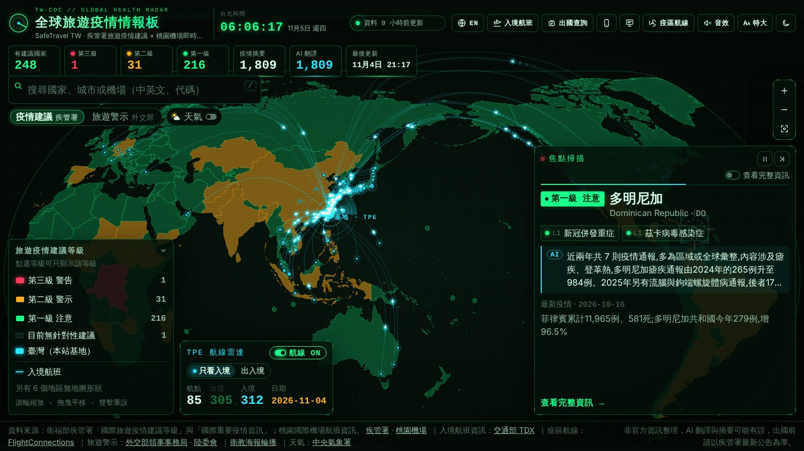

| 國家面板 / Country panel | 入境航班看板 / Inbound flights board |
|---|---|
| 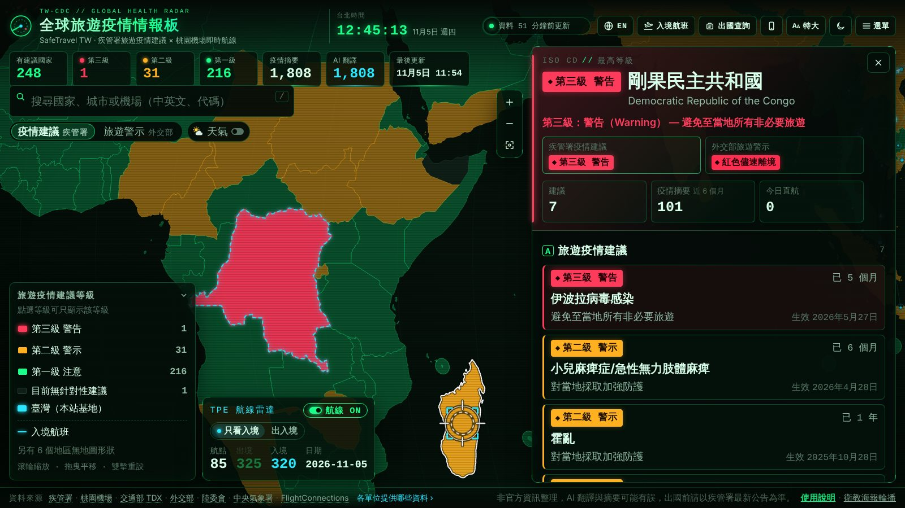 | 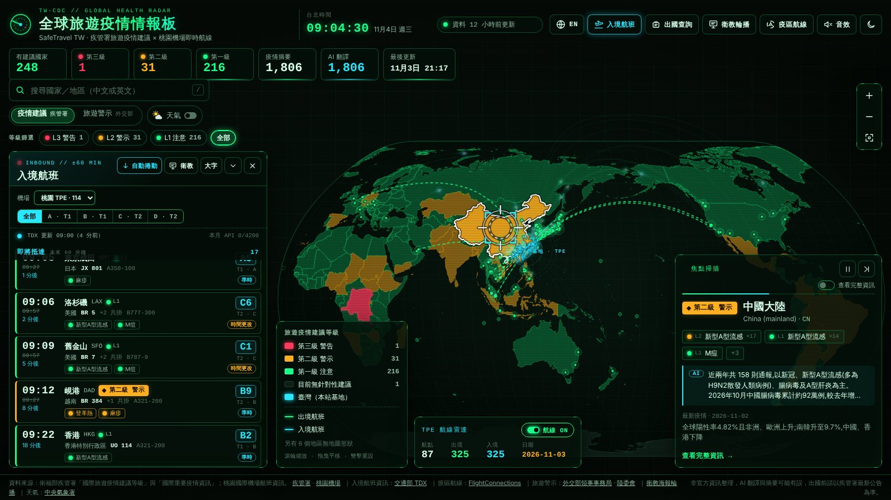 |
| **選單（電腦版）/ Menu (desktop)** | **可拖曳的國家面板 / Draggable country panel** |
| 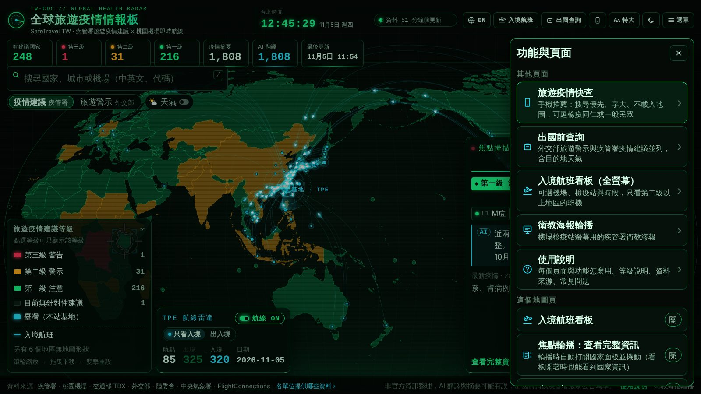 | 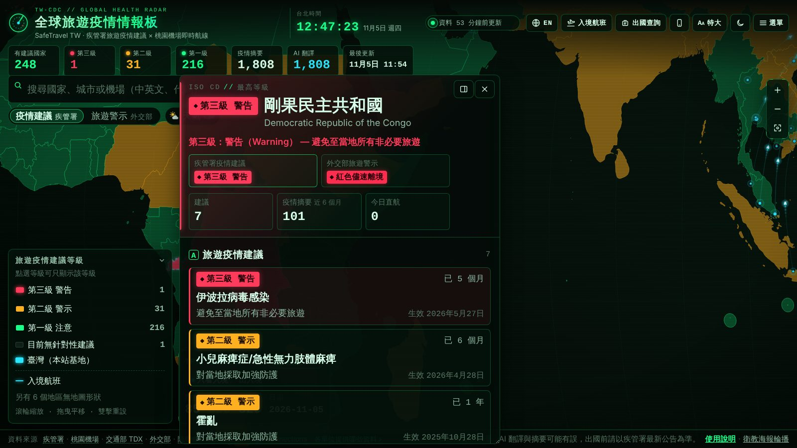 |
| **圖例即等級篩選（只看第二、三級）/ Legend as level filter** | **全螢幕入境航班看板 / Full-screen arrivals board (`arrivals.html`)** |
| 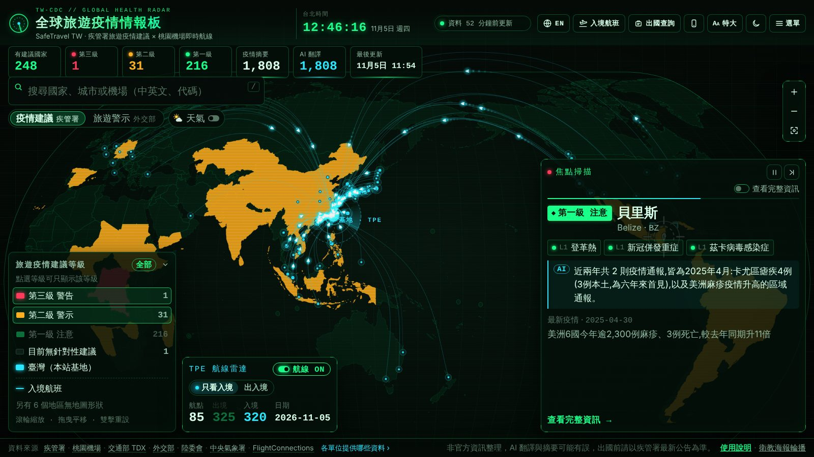 | 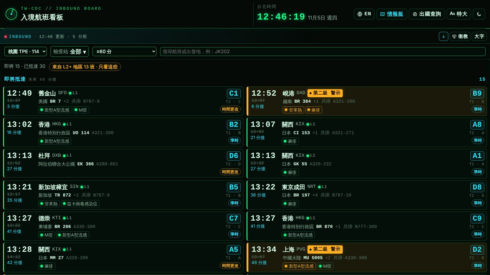 |
| **疫區航線監測 / Outbreak route watch** | **淺色主題（英文）/ Light theme (English)** |
| 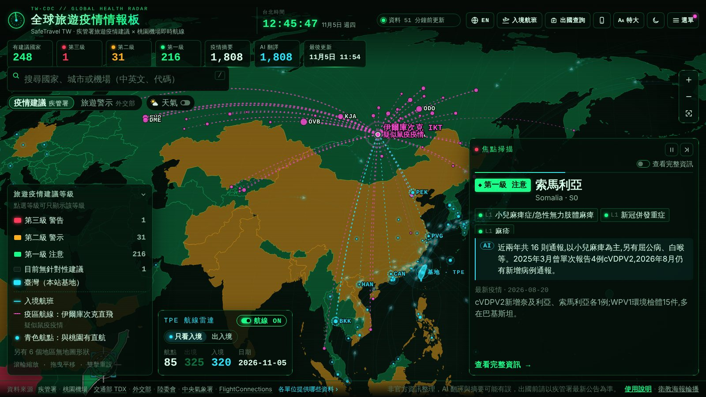 | 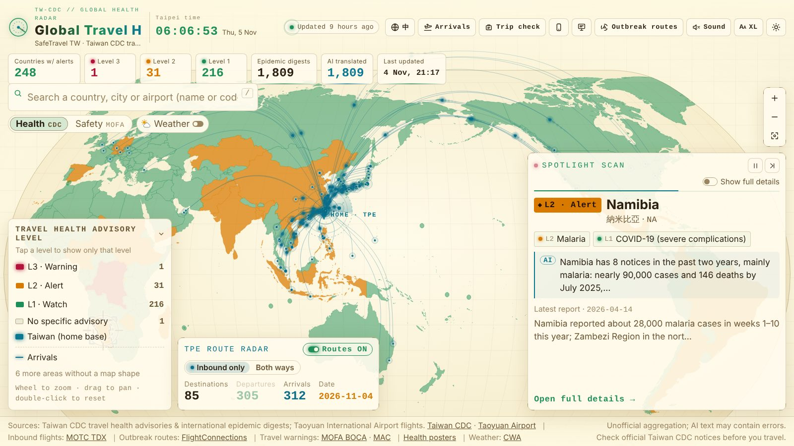 |
| **旅遊警示圖層 / Travel-warning layer** | **出國前旅遊安全查詢 / Pre-trip safety check** |
| 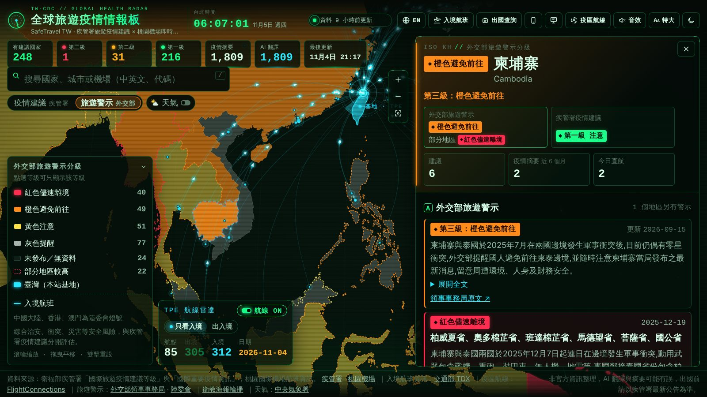 | 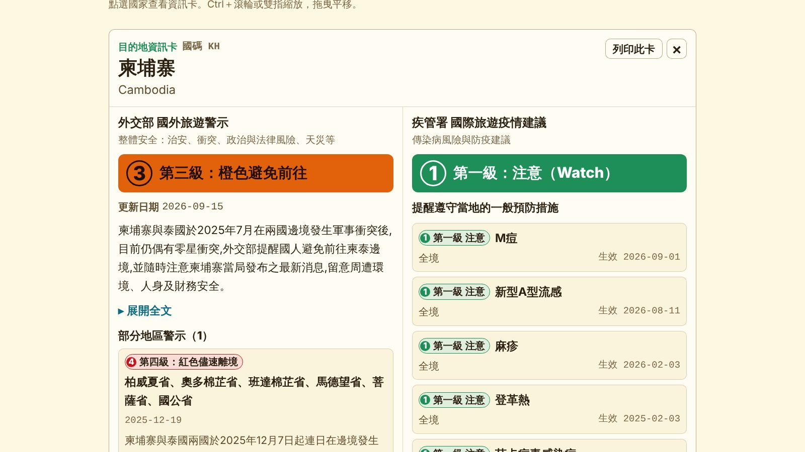 |
| **出國前健康準備（疾管署國際旅遊處方箋）/ Health preparation** | **旅遊醫學門診 / Travel medicine clinics** |
| 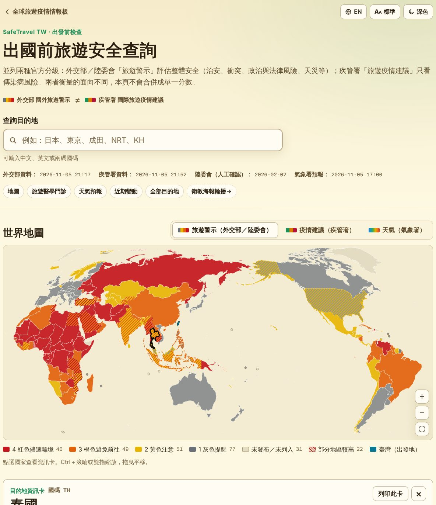 | 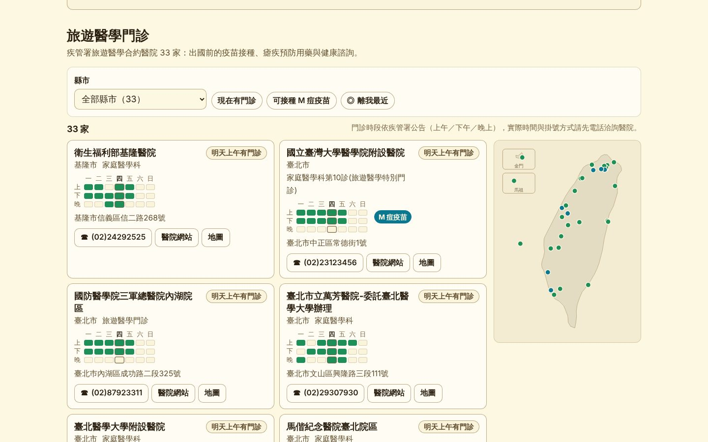 |

| 直式牆面螢幕 / Portrait wall screen | 手機選單 / Phone menu | 衛教海報輪播 / Health posters |
|---|---|---|
| 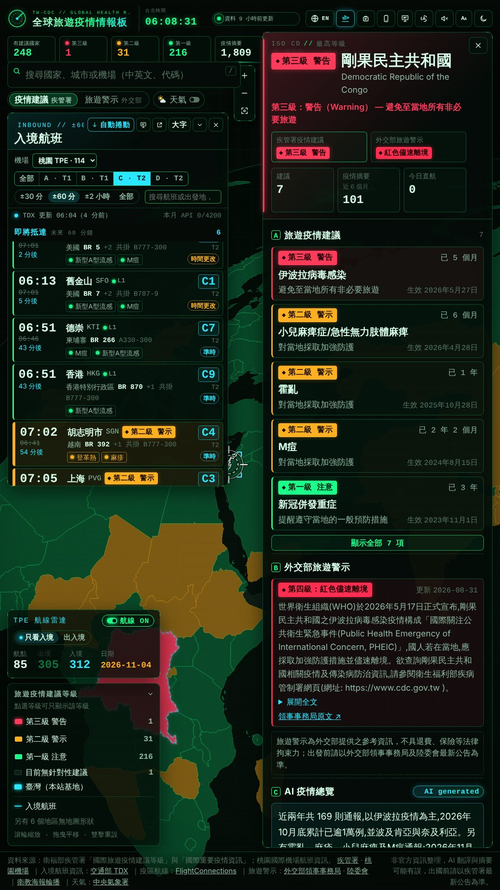 |  |  |

| 快查：檢疫同仁 / Quick check: staff | 快查：一般民眾 / Quick check: traveller | 手機地圖（英文）/ Phone map (English) |
|---|---|---|
| 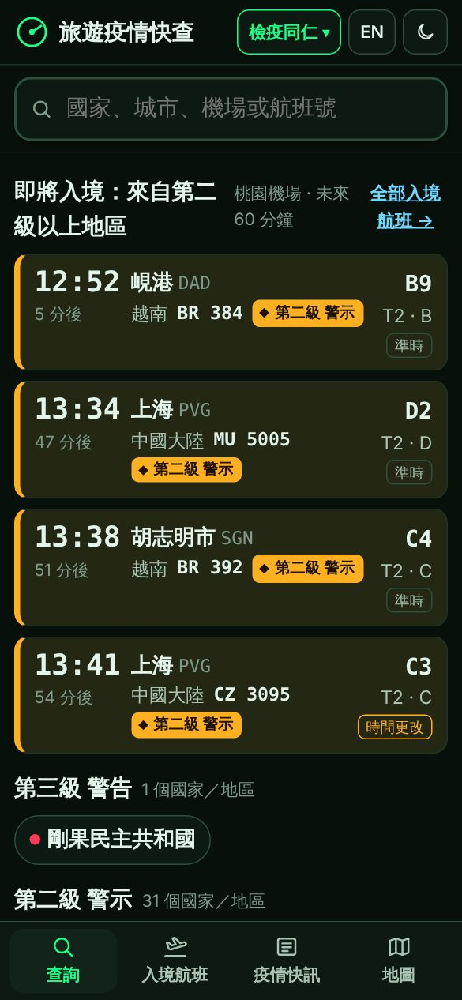 | 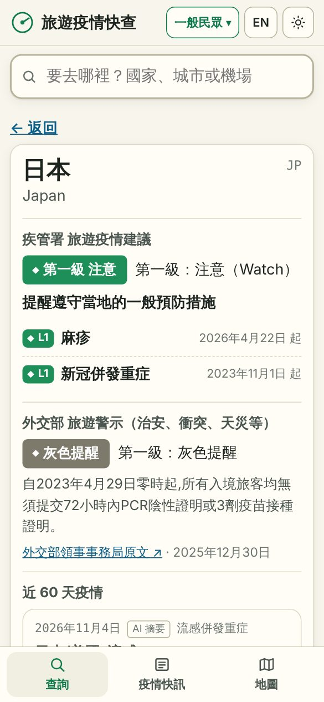 | 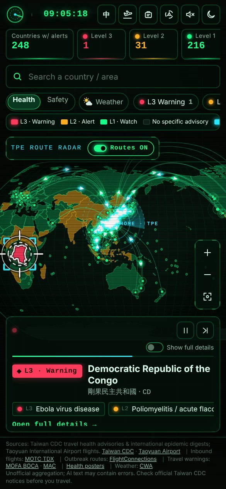 |

---

## 繁體中文

### 這是什麼

SafeTravel TW 是一個部署在 GitHub Pages 的靜態網站，把臺灣疾病管制署（疾管署）的「國際旅遊疫情建議等級」與「國際重要疫情資訊」、外交部領事事務局的「國外旅遊警示分級」（中國大陸、香港、澳門為陸委會燈號），結合交通部 TDX 的即時航班資料，整理成一張可互動的世界地圖，並另有給民眾與旅行社使用的出國前查詢頁：

- **旅遊疫情建議地圖**：依各國最高建議等級上色（第一級注意、第二級警示、第三級警告），已解除的建議不顯示。
- **國家面板**：點選國家可看到所有有效建議（同疾病的多個省分會合併顯示）、AI 兩年疫情總覽，以及疫情時間軸（預設近 6 個月，可切換 3 個月／6 個月／1 年／2 年，每台螢幕記住自己的選擇；中英對照，可展開全文、連回疾管署原文）。
- **焦點輪播**：每 15 秒自動介紹一個國家；可切換「查看完整資訊」自動開啟國家面板，並以與入境航班看板相同的閱讀速度自動捲動。面板開著時，上方的輪播列也有「自動捲動」開關與「精簡資訊」按鈕（回到只有右下角卡片的精簡輪播）。「查看完整資訊」也可在右上角「選單」切換（看板開著、焦點卡片收起時也找得到），展示機網址可加 `?full=1`。
- **桃園機場航線雷達**：以當日桃園機場（TPE）航點畫出動態航線，預設只看入境，可切換出入境。
- **入境航班看板**（給機場檢疫站）：目前時間前後 60 分鐘（可改 30 分、2 小時或全部）內抵達的國際客機，來自第二級以上地區的班機特別標示，也有不含地圖的全螢幕版 `arrivals.html`；可依機場與檢疫站（桃園 A、B＝第一航廈，C、D＝第二航廈）篩選，並顯示出發地國家的建議等級與主要疫病。
- **旅遊警示圖層**：地圖可切換為外交部領事事務局「國外旅遊警示分級」（灰、黃、橙、紅；中國大陸、香港、澳門為陸委會燈號），評估治安、衝突、災害等整體安全，與疾管署的疫情建議分開呈現、不合併成單一分數；部分地區較高的國家以虛線標示。英文版顯示外交部摘要的非官方英譯，全文為中文原文。
- **出國前旅遊安全查詢**（[`trip.html`](https://ancientsky.github.io/safetravel/trip.html)，給民眾與旅行社）：查詢目的地即可並列兩種官方分級、各地區警示與近期疫情；另有三圖層世界地圖（旅遊警示／疫情建議／天氣：80 個城市的天氣與最高溫標在地圖上，可逐日切換或播放）、**全球都市天氣預報**（中央氣象署 80 個城市未來 7 天，可依地區篩選、°C／°F 切換，點城市即開啟該國資訊卡，資訊卡內也列出當地城市預報）、近期變動、全部目的地表格（篩選、排序、匯出 CSV、列印）。資訊卡另有**出國前健康準備**（疾管署「國際旅遊處方箋」：疫苗與預防用藥的說明與入境規定、依傳染途徑整理的當地疾病與預防、駐外館處急難專線可直接撥打；勾選「與嬰幼兒同行、懷孕、慢性病、免疫不全、長期居留、海外志工」會顯示疾管署針對這些旅客的補充建議），頁面有**旅遊醫學門診**（33 家合約醫院：縣市、現在有門診、M 痘疫苗篩選，離我最近排序，一週門診表、電話與地圖）。預設淺色主題。
- **旅遊疫情快查**（[`m.html`](https://ancientsky.github.io/safetravel/m.html)，給自己的手機或電腦）：不載入地圖、字大、搜尋優先的個人版。第一次開啟選擇身分（之後右上角隨時切換，或網址 `?role=officer／public`）——**檢疫同仁**：首頁列出未來 60 分鐘來自第二級以上地區的入境班機，搜尋框也能查航班號（`BR384`），國家卡片附今日自該國入境的班機，另有「入境航班」分頁（時段、只看 L2+）；**一般民眾**：熱門目的地、疫情建議與外交部旅遊警示摘要、近 60 天疫情。兩者都有「疫情快訊」分頁（近 60 天，可只看第二級以上國家）。手機開啟地圖版時會提示一次改用快查（可關閉）；之後也可從地圖版右上角「**選單**」進入。
- **使用說明**（[`help.html`](https://ancientsky.github.io/safetravel/help.html)，給同事與旅客）：每個頁面與功能怎麼用、展示螢幕網址設定、等級說明、各資料來源提供什麼與更新時間、常見問題；中英文、深淺色。手機在地圖頁「選單」、電腦在頁尾都能找到。**新增或修改功能時，請一併更新此頁**。
- **衛教海報輪播**（[`slide.html`](https://ancientsky.github.io/safetravel/slide.html)，給機場檢疫站螢幕）：疾管署衛教海報（伊波拉疫情警示、入境症狀報到、症狀提醒、別把病菌帶回國）以 HTML 重新排版並加上短暫進場動畫，直式 1080×1920／橫式 1920×1080 各有版面，自動縮放到任何螢幕；伊波拉海報的地圖以轉機航線（金夏沙經巴黎或阿布達比轉機來臺）示意、不標地名以免標籤化。海報清單 `web/slides/slides.json` 可設定啟用、起訖日期與停留秒數；**現成的海報圖檔丟進 `web/slides/auto/` 資料夾就會自動上架**（檔名可帶上架／下架日期、秒數、直式／橫式），刪除即下架。螢幕每 5 分鐘自動更新清單；可列印或另存 PDF，並由 GitHub Actions 自動輸出 PNG。維護方式見 [SLIDES.md](docs/SLIDES.md)。
- **疫區航線監測**：在地圖上顯示疫情城市的直飛航線網（目前有伊爾庫次克〔疑似鼠疫〕與金夏沙〔本迪布焦病毒 BDBV 伊波拉疫情〕），標出與桃園有直航、可能轉機來臺的航點，以及已通報輸出病例的航點。
- **繁中／英文**、**深色（預設）／淺色主題**、可開關的**神秘音效**；資料或網站程式更新後畫面會在不打擾使用的時機**自動重新載入**，適合長時間開著的展示螢幕；也可用 [`scripts/mirror/`](docs/MIRROR.md) 部署成署內鏡像站，供 kiosk 使用而不重覆抓取資料。

### 使用說明

**右上角工具列**

| 按鈕 | 功能 |
|---|---|
| EN／中 | 切換語言 |
| 入境航班 | 開關入境航班看板（預設關閉） |
| 出國查詢 | 前往出國前旅遊安全查詢頁（`trip.html`） |
| 快查 | 前往「旅遊疫情快查」（`m.html`）：搜尋優先、字大、不載入地圖，適合自己的電腦與手機（手機版在「選單」裡） |
| Aa 字級 | 切換字體大小：小（100%）→ 標準（112%）→ 大（125%）→ 特大（140%，桌機與牆面螢幕預設），每台螢幕記住；手機預設「標準」；畫面高度不到 900 px（筆電或瀏覽器放大 125% 以上）時「特大」自動以「大」顯示並隱藏統計數字卡。也可用網址 `?text=s／m／l／xl` 固定 |
| 月亮／太陽 | 切換深色／淺色主題 |
| 選單 | 手機與電腦都有：其他頁面（快查、出國前查詢、全螢幕入境航班看板、衛教海報輪播、使用說明）與這頁的功能——**焦點輪播：查看完整資訊**、**疫區航線**（開啟監測選單；開啟時選單按鈕出現小紅點）、**音效**（預設關閉）、字級、深淺色、語言，並顯示目前狀態 |

**手機版選單**：手機上地圖頁的標題列只留「入境航班」和「**選單**」（電腦版另有語言、出國查詢、快查、字級、主題按鈕）；選單列出其他頁面（旅遊疫情快查、出國前查詢、全螢幕入境航班看板、衛教海報輪播，各附一句說明）與這一頁的功能（入境航班看板、疫區航線、字體大小、深色／淺色、English、音效，並顯示目前狀態）。

**地圖操作**：滾輪縮放、拖曳平移、雙擊重設；按 `/` 跳到搜尋框，`Esc` 關閉國家面板。搜尋框可輸入國家、**城市或機場**（中英文名稱、常見俗稱或機場代碼，例如「成田」「曼谷」「名古屋」「NRT」），選取後開啟該國面板（出國前查詢頁的搜尋也一樣）。左上可切換「疫情建議・疾管署／旅遊警示・外交部」圖層；**左下圖例就是等級篩選**：點某一等級只顯示該等級（可複選，「全部」還原），圖例右上 ⌄ 可收合（每台螢幕記住）。**國家面板可拖曳**：按住面板最上方拖到任何位置、右下角調整大小（每台螢幕記住），▯ 按鈕放回右側。旁邊的「天氣」開關（預設關閉）會在地圖上疊加中央氣象署 80 個城市的天氣與最高溫，可逐日切換或播放，國家面板也會多一段「當地天氣預報」；圖例旁的「航線雷達」預設**只看入境**航線（全部同一顏色），可切到「出入境」或關閉動畫；入境航班看板停靠在左側時，航線雷達縮成開關、圖例收成標題列（點一下展開），讓出地圖空間；開著國家面板或入境航班看板時，右下的焦點卡片會自動收起（輪播照常進行；想同時看國家資訊，在「選單」打開「焦點輪播：查看完整資訊」）；開啟疫區航線時，圖例會說明虛線代表哪個疫區的直飛航線。手機上單指點選國家、雙指才移動縮放地圖，避免誤觸。滑鼠提示與國家面板一律並列兩種分級；國家面板的「外交部旅遊警示」區塊可展開全文並連回領事事務局原文。

**入境航班看板**

- 選擇**機場**與**檢疫站**（「檢疫站」按鈕可**同時勾選多個**，例如 B 和 C；桃園 A·T1、B·T1、C·T2、D·T2；其他機場只有「全部」）。登機門未定或停靠遠端機坪的航班，會同時列在該航廈的每個檢疫站。
- **查詢時段**（下拉選單）：前後 30 分、60 分（預設）、2 小時，或「全部」（資料涵蓋的前 2 小時～後 4 小時），每台螢幕記住。
- **需注意的班機**：來自第二級（警示）以上地區的班機整列加底色、左側色條加粗；摘要列的「來自 L2+ 地區 N 班 · 只看這些」按一下只列出這些班機，再按一次顯示全部。
- **獨立看板** [`arrivals.html`](https://ancientsky.github.io/safetravel/arrivals.html)：全螢幕的入境航班看板（不載入地圖，適合檢疫站櫃台的平板或螢幕；寬螢幕分兩欄），點一列開啟該國的出國前查詢卡片。地圖頁看板上的 ↗ 按鈕會以相同機場、檢疫站與時段開啟它。
- **搜尋航班**：輸入航班號碼（`JK202`、`JK-202`、`jk 202` 都可以，共掛班號也找得到）或出發地（`NRT`、`東京`，也認得機場的俗稱與城市名，如 `名古屋`、`Nagoya`、`セントレア` 都能找到「中部」NGO）即可篩選；搜尋時不分檢疫站，並涵蓋前 2 小時到後 4 小時的航班，按 `Esc` 清除。
- 每列顯示：預計／實際抵達時間（表定時間不同時以刪除線標示）、距今分鐘數、出發地城市與國家、**出發國的建議等級與主要疫病**、航班與共掛班號、機型、**登機門／航廈／檢疫站**、**行李轉盤**（桃園機場降落前即已分配）、狀態（準時、延誤、已抵達、取消…）。
- 點一列即開啟該出發國的國家面板；滑鼠移到列上會在地圖上亮出該航線。
- 「**自動捲動**」（預設開啟）：列表以閱讀速度往下捲，到底後回到頂端；移動滑鼠時暫停 8 秒，觸控、滾輪或點擊後暫停 15 秒，游標停在列表上不會擋住捲動。「**大字**」適合牆面螢幕。
- 拖曳標題列可把看板移到任何位置（橫式、直式各自記住），「歸位」按鈕回到預設位置；也可縮小成只剩標題列。
- 資料約每 10 分鐘更新一次（00:00–04:59 約每 30 分鐘），標題「INBOUND」旁顯示資料更新時間（本月 TDX API 用量以小字放在頁尾）；資料延遲時會變成橘色提示。

**疫區航線監測**：按「疫區航線」→ 打開「伊爾庫次克 IKT」或「金夏沙 FIH」開關（可同時開）。地圖會縮放到剛打開的航線網，線越粗代表每月航班越多；**青色**為與桃園有直航的航點（伊爾庫次克：曼谷、北京、上海、廣州、河內；金夏沙：巴黎、阿布達比），**紅色警示圈**為已通報輸出病例的航點（金夏沙→奈洛比），淡色虛線為清單中列出、但目前無定期班次的航線。選單內有航點數、每月航班、各國分布與前五大航點；開啟期間焦點輪播不會移動地圖。

**直接連結（書籤／牆面螢幕用）**

| 網址 | 效果 |
|---|---|
| `…/safetravel/#/country/CD` | 直接開啟某國家面板（ISO 兩碼代碼） |
| `…/safetravel/?arr=TPE-C` | 開啟入境航班看板：桃園、C 檢疫站（`TPE-A`～`TPE-D`；多個檢疫站：`TPE-BC`） |
| `…/safetravel/?arr=KHH` | 其他機場：`TSA` 松山、`KHH` 高雄、`RMQ` 臺中… |
| `…/safetravel/?arr=TPE-C&big=1` | 同上，大字模式 |
| `…/safetravel/arrivals.html?arr=TPE-C&win=30` | 獨立入境航班看板：桃園 C 檢疫站、前後 30 分鐘（`win=30／60／120／all`） |
| `…/safetravel/?watch=irkutsk` | 開啟伊爾庫次克疫區航線圖（`kinshasa` 金夏沙；兩個都開：`?watch=irkutsk,kinshasa`） |
| `…/safetravel/?layer=mofa` | 以外交部旅遊警示圖層開啟地圖（`cdc` 為疫情建議） |
| `…/safetravel/?wx=1` | 開啟天氣圖層（`?wx=0` 關閉） |
| `…/safetravel/?text=l` | 固定字體大小（`s` 小、`m` 標準、`l` 大、`xl` 特大；不會改掉該螢幕記住的設定） |
| `…/safetravel/?routes=both` | 航線雷達顯示出入境（預設 `in` 只看入境；不會改掉該螢幕記住的設定） |
| `…/safetravel/?months=6` | 國家面板疫情時間軸的範圍（`3`、`6`、`12`、`24` 個月；不寫則用該螢幕上次的選擇，預設 6） |
| `…/safetravel/?full=1` | 焦點輪播「查看完整資訊」：輪播時自動開啟並捲動國家面板（`?full=0` 關閉；不會改掉該螢幕記住的設定） |
| `…/safetravel/?osk=1` | 觸控 kiosk 專用**螢幕小鍵盤**：點搜尋框就出現，有注音（大千排列，選字＋聯想詞，地名優先）、英數與常用目的地按鈕；在同一個瀏覽器工作階段內切到出國前查詢頁也有效，`?osk=0` 關閉。一般電腦與手機不加這個參數就完全不載入 |
| `…/safetravel/trip.html#KH` | 出國前查詢頁，直接開啟某目的地資訊卡 |
| `…/safetravel/slide.html?interval=8&orient=landscape` | 衛教海報輪播：每張 8 秒、橫式（`orient=portrait`／`auto`） |
| `…/safetravel/slide.html?only=ebola-drc-zh,report-zh&lang=zh` | 只播指定海報／只播中文與雙語海報（見 [SLIDES.md](docs/SLIDES.md)） |

參數可以合併，例如 `?arr=TPE-C&big=1&watch=irkutsk`。

**牆面螢幕建議**

- **橫式**：入境航班看板停靠在左側，地圖自動移到右邊，國家面板從右側打開，兩者並排。
- **直式**：看板停靠在上方，地圖重新排在下方；國家面板打開時看板會縮到面板左側，輪播放大的國家也會避開看板。
- 開啟「查看完整資訊」（焦點卡片上的開關，或「選單」→「焦點輪播：查看完整資訊」，或網址 `?full=1`）與「自動捲動」即可無人值守輪播。疫情資料更新或網站程式更新時，頁面都會在不打擾使用的時機自動重新載入（入境航班的 10 分鐘更新不會重新載入頁面）。出國前查詢頁（無人操作 5 分鐘後）與海報輪播（換下一張海報時）也一樣會自動更新。

### 資料更新排程

| 時間（台北） | 工作 | 觸發方式 |
|---|---|---|
| 每天 11:17、21:17 | 抓疾管署 CSV、TPE 航班、外交部旅遊警示、中央氣象署全球都市天氣預報與數個國家的疾管署國際旅遊處方箋網頁 → SQLite（含警示等級變動紀錄）→ 匯出 JSON → 部署 | cron-job.org → `update-data.yml` |
| 每天 11:52 | 翻譯新的疫情資訊與外交部旅遊警示摘要、更新各國兩年總覽與新病名（Claude 排程；無須 Gemini） | Claude Code 排程（[docs/TRANSLATION_GUIDE.md](docs/TRANSLATION_GUIDE.md)） |
| 陸委會宣布調整時 | 更新中國大陸、香港、澳門燈號（陸委會網站擋自動抓取） | 人工編輯 `data/manual/mac_warnings.json` |
| 每月（疾管署更新開放資料後） | 旅遊醫學門診與國際旅遊處方箋 CSV（`od.cdc.gov.tw` 擋 GitHub 主機）；各國處方箋網頁則隨每天兩次的更新自動檢查 | 人工上傳到 `data/raw/travelmed/`（見該資料夾 README） |
| 05:00–23:59 每 10 分鐘；00:00–04:59 每 30 分鐘 | 入境航班（TDX，一次呼叫涵蓋全台機場）→ 直接發布到 Pages | cron-job.org → `arrivals.yml` |

GitHub 內建的 `schedule` 在本 repo 實測會晚 4.5–8.5 小時才執行，因此已移除，改由 cron-job.org 透過 `workflow_dispatch` 準時觸發（設定方式：[docs/ARRIVALS_SETUP.md](docs/ARRIVALS_SETUP.md)）。入境航班每次執行前會先檢查資料新舊與本月用量（不耗 API 額度），TDX 免費方案每月 4,500 次內預留約 12% 緩衝。

### 架構

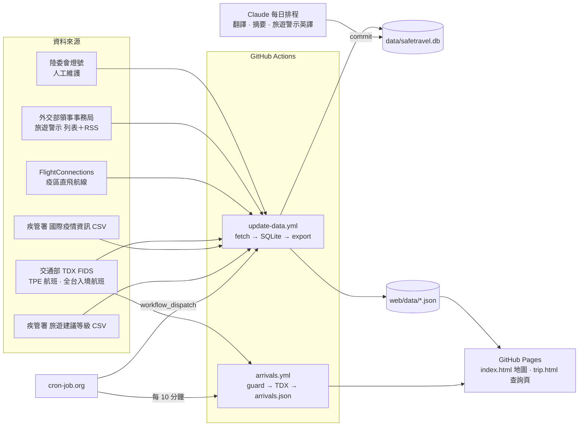

- **pipeline/**（Python）：`fetch` 抓資料 → `load` 寫入 SQLite（歷史與翻譯快取）→ `enrich`（選用 Gemini）→ `export` 輸出 `web/data/*.json`；`mofa` 處理外交部／陸委會旅遊警示（`warnings.json`）；`arrivals` 產生入境航班；`watch` 產生疫區航線；`pending`／`import_translations.py` 供每日翻譯排程取出與匯入待翻文字；`validate` 依資料合約檢查所有輸出。
- **web/**：無建置步驟的 ES modules，D3 v7（只打包用到的函式，清單見 `scripts/d3-entry.mjs`）與 topojson-client 已 vendor 於 `web/vendor/`，以相對路徑部署在 `/safetravel/` 子路徑，CSP 限制只連自身網域。
- 詳細設計：[ARCHITECTURE](docs/ARCHITECTURE.md) · 資料合約：[DATA_CONTRACT](docs/DATA_CONTRACT.md) · 入境航班設計：[ARRIVALS](docs/ARRIVALS.md) · 設定步驟：[ARRIVALS_SETUP](docs/ARRIVALS_SETUP.md) · 旅遊警示：[WARNINGS](docs/WARNINGS.md) · 翻譯排程：[TRANSLATION_GUIDE](docs/TRANSLATION_GUIDE.md) · 維運：[OPERATIONS](docs/OPERATIONS.md)

### 署內鏡像站

要在署內 Linux 主機（nginx）提供同一個網站給 kiosk 使用、又不重覆抓取資料：署內主機每 5 分鐘從 GitHub 複製已處理好的網站（`scripts/mirror/`：同步程式、systemd timer、nginx 設定、安裝程式），不連任何資料來源、不需要 API 金鑰。安裝、nginx 設定、30–50 台 kiosk 的建議規格與維運方式見 [docs/MIRROR.md](docs/MIRROR.md)。

### 資料來源

| 資料 | 來源 |
|---|---|
| 國際旅遊疫情建議等級（全歷史） | 疾管署 `CountryEpidLevel/ExportCSV`（完整網址見 [ARCHITECTURE.md](docs/ARCHITECTURE.md#data-sources)） |
| 國際重要疫情資訊（約兩年） | 疾管署 `TravelEpidemic/ExportCSV` |
| 桃園機場航線、全台入境航班 | [交通部 TDX 運輸資料流通服務](https://tdx.transportdata.tw/) FIDS API（`/v2/Air/FIDS/Airport/TPE`、`/v2/Air/FIDS/Airport/Arrival`） |
| 國外旅遊警示分級 | [外交部領事事務局](https://www.boca.gov.tw/sp-trwa-list-1.html)列表頁與 RSS（每日兩次，見 [WARNINGS.md](docs/WARNINGS.md)） |
| 中國大陸、香港、澳門旅遊警示 | [陸委會](https://www.mac.gov.tw/News.aspx?n=E0243AD02975213D&sms=EF1DC35EB9749B36)：網站有 Cloudflare 驗證，燈號以人工維護於 `data/manual/mac_warnings.json` |
| 國際旅遊處方箋、旅遊醫學門診 | 疾管署開放資料 `od.cdc.gov.tw/quarantine/`（TMPrescription、TMClinicsList、ClinicsTime，每月；GitHub 主機連不上，由人工上傳到 `data/raw/travelmed/`）與各國[國際旅遊處方箋網頁](https://www.cdc.gov.tw/Internationaltravel/Index/ZkNLTkRxQ0NyQmc5Rk50dmZZZlI2Zz09)（每次更新檢查數個國家），見 [TRAVELMED.md](docs/TRAVELMED.md) |
| 全球都市天氣預報 | [中央氣象署開放資料 F-C0032-007](https://opendata.cwa.gov.tw/dataset/forecast/F-C0032-007)（需 API 授權碼，存於 Secret `CWA`）；城市英文名與國家對應見 `data/manual/cwa_cities.json` |
| 疫區直飛航線（伊爾庫次克、金夏沙） | [FlightConnections](https://www.flightconnections.com/)：直飛航點與每月航班數，整理於 `data/manual/watch/`（2026-10） |
| 機場座標 | [OpenFlights `airports.dat`](https://openflights.org/data.html) |
| 世界地圖、國家代碼與名稱 | [world-atlas](https://github.com/topojson/world-atlas)（50m／110m）、[world-countries](https://github.com/mledoze/countries) |
| 前端函式庫 | [D3 v7](https://d3js.org/)、[topojson-client](https://github.com/topojson/topojson-client) |

### 旅遊建議等級如何計算

1. **每列是一則公告**：目前狀態取 `(疾病, ISO 代碼, 行政區)` 的最新一列；最新一列為「解除」即不顯示。
2. **COVID-19 舊名稱不計**：「嚴重特殊傳染性肺炎」整個捨棄，只計 2023-11-01 起的「新冠併發重症」。
3. **全球建議套用到所有國家**：同一疾病、同一等級在 150 國以上（目前為「新冠併發重症」第一級）視為全球建議，套用到地圖上所有國家（臺灣、南極除外），計入地圖顏色與各國最高等級；面板中標示為「全球」。
4. **國家等級取最高值**：含次級行政區（例如中國大陸的北京市）。同疾病同等級的多個省分合併成一組顯示。
5. **代碼**：納米比亞的 ISO 代碼是 `NA`，讀取時必須保留為字串；沒有代碼的地區以 `data/manual/territories.json` 對應，仍對應不到者（例如索馬利蘭 `SMLL`）列為「未對應」。

### 旅遊警示如何呈現

1. **兩種分級分開呈現**：疾管署評估傳染病風險（三級），外交部評估整體安全（四色）；地圖一次只依一種上色，提示框、國家面板與 `trip.html` 一律並列兩者，不合併成單一分數。
2. **國家燈號取「全境」等級**：外交部只對部分地區發布較高警示時（例如柬埔寨全境橙色、柬泰邊境省份紅色），地圖以虛線標示「部分地區較高」，面板逐一列出各地區等級。
3. **對應國家代碼**：外交部列表頁提供地區所屬國家，依 `data/manual/boca_names.json` → 國家名稱表 → 疾管署名稱比對成 ISO 代碼；對應不到者（目前只有索馬利蘭）列為「未對應」。
4. **陸港澳**：由陸委會發布，網站擋自動抓取，燈號以人工維護於 `data/manual/mac_warnings.json`，畫面上標示最後核對日期。
5. **變動紀錄**：每次更新與前次比對，等級變動、新增或撤銷都記錄在 SQLite，`trip.html` 的「近期變動」列出近 60 天的變動。
6. **英文**：外交部只發布中文；摘要與地區名稱由每日排程翻譯（非官方英譯），「展開全文」顯示中文原文。

### 本機開發

需要 **Python 3.14**（`.python-version`）與 **Node.js 24**（`.nvmrc`，目前 24.22.1）；GitHub Actions 使用相同版本。

```bash
python -m pip install -r pipeline/requirements.txt
python -m pipeline run --offline          # 只用 data/raw/ 的離線樣本：不連網、不呼叫 AI
python -m pipeline export                 # 由 SQLite 重新匯出 JSON（也會重建 watch.json）
python -m pipeline arrivals --offline data/raw/flights/latest/tdx_fids_tpe.json --shift-to-now   # 入境航班樣本
python -m pipeline watch                  # 重建疫區航線 web/data/watch.json
python -m pipeline warnings               # 重建旅遊警示 web/data/warnings.json（用 data/raw/boca/ 的樣本）
python -m pipeline pending --out /tmp/pend   # 列出待翻譯的疫情資訊與旅遊警示（翻譯流程見 TRANSLATION_GUIDE）
python -m pipeline validate               # 依資料合約檢查 web/data
python -m pytest pipeline/tests -q        # 單元測試
python -m http.server -d web 8080         # 預覽：http://localhost:8080/
node tests/smoke.mjs http://localhost:8080/            # 主站冒煙測試（需 Playwright 與 Chromium）
node tests/trip-smoke.mjs http://localhost:8080/trip.html   # 出國前查詢頁冒煙測試
node tests/slide-smoke.mjs http://localhost:8080/slide.html # 衛教海報輪播冒煙測試
node scripts/export-slides.mjs http://localhost:8080/       # 輸出海報 PNG 到 web/slides/export/（加 --pdf-dir 目錄 另存 PDF）
npm ci && npm run vendor && node scripts/check-d3.mjs  # 重建 web/vendor/（D3 只打包 scripts/d3-entry.mjs 列出的函式）
```

前端要用新的 D3 函式時，先加到 `scripts/d3-entry.mjs` 再執行 `npm run vendor`；部署流程會執行 `scripts/check-d3.mjs`，用到未打包的函式就會擋下部署。

新增疫區航線：在 `data/manual/watch/` 放一份 `<id>.json`（城市、原因、來源、日期）與對應的航線 CSV（`Country,City_Airport,IATA,Monthly_Flights,City_zh`），執行 `python -m pipeline watch`，選單就會多一個開關。格式見 [DATA_CONTRACT.md](docs/DATA_CONTRACT.md#watchjson-outbreak-route-watch)。

### GitHub 設定檢查清單

- [ ] **Pages**：Settings → Pages → Source 選 **GitHub Actions**。
- [ ] **Workflow 權限**：Settings → Actions → General → Workflow permissions 允許讀寫（`update-data.yml` 會 commit 資料）。
- [ ] **中央氣象署授權碼**：Secret `CWA`（全球都市天氣預報；沒有時沿用上次下載的資料）。
- [ ] **TDX 金鑰**：Secrets 新增 `TDX_CLIENT_ID`、`TDX_CLIENT_SECRET`（入境航班需要；TPE 航線沒有金鑰時以匿名額度呼叫）。選填變數 `ARRIVALS_MONTHLY_CAP`（預設 4200）。
- [ ] **外部排程**：建立只有「Actions 讀寫」權限的 fine-grained PAT，在 cron-job.org 設定兩個排程（步驟見 [docs/ARRIVALS_SETUP.md](docs/ARRIVALS_SETUP.md)）。PAT 到期前記得更換。
- [ ] **翻譯**：預設由每日 Claude 排程處理（疫情資訊、各國總覽、病名、外交部旅遊警示摘要）；若改用 Gemini，設定變數 `AI_PROVIDER=gemini` 與 Secret `GEMINI_API_KEY`（選填 `GEMINI_MODEL`）。
- [ ] **陸委會燈號**：陸委會調整中國大陸、香港、澳門旅遊警示時，更新 `data/manual/mac_warnings.json` 的燈號、日期、摘要與 `confirmed`（核對日期）。
- [ ] **旅遊醫學資料（每月）**：在臺灣的網路下載 `od.cdc.gov.tw/quarantine/` 的 `TMClinicsList.csv`、`ClinicsTime.csv`、`TMPrescription.csv`，上傳到 `data/raw/travelmed/`（檔名不變）。
- [ ] **手動執行**：Actions → *Update data* 或 *Arrivals board* → Run workflow。

### 免責聲明

本網站為非官方的資料整理與視覺化專案，**不構成醫療建議**。旅遊健康相關決策請以**臺灣疾病管制署（<https://www.cdc.gov.tw/>）**及當地主管機關公告為準；旅遊安全請以**外交部領事事務局（<https://www.boca.gov.tw/>）**與**陸委會**最新公告為準，旅遊警示僅供參考，不具退費、保險等法律拘束力。AI 翻譯與摘要可能有誤，請以原文為準；航班資料以機場與航空公司公告為準。資料可能因來源延遲或格式變更而不完整。

### 授權

- **程式碼**：MIT License，見 [LICENSE](LICENSE)。
- **資料**：疾管署、外交部領事事務局、中央氣象署與交通部 TDX 資料依[政府資料開放授權條款](https://data.gov.tw/license)使用，陸委會燈號摘錄自其公告，著作權屬原機關所有；使用時請標示來源與資料時間。
- **第三方資料**：OpenFlights、world-atlas、world-countries 等依其各自授權條款使用。

---

## English

### What is this

SafeTravel TW is a static GitHub Pages dashboard that combines Taiwan CDC (TCDC) international travel-health advisories and epidemic digests, the Ministry of Foreign Affairs (MOFA/BOCA) travel warnings (Mainland Affairs Council ratings for mainland China, Hong Kong and Macau) and live flight data from Taiwan's Ministry of Transportation (TDX), plus a pre-trip lookup page for travellers and travel agencies:

- **Advisory map** coloured by each country's highest active level (Level 1 Watch, 2 Alert, 3 Warning); lifted advisories are removed.
- **Country panel** with every active advisory (provinces with the same disease grouped), an AI two-year overview and an epidemic timeline (past 6 months by default; 3 / 6 / 12 / 24 months, remembered per screen; zh/en, full text, link to the TCDC original).
- **Spotlight tour** that presents a country every 15 s, optionally opening the full panel and auto-scrolling it at the arrivals board's reading pace; while the panel is open its tour bar carries the auto-scroll switch and a *Compact* button back to the corner-card tour. “Show full details” is also in the Menu (reachable while the card is hidden by an open board), or `?full=1` for kiosks.
- **TPE route radar**: animated routes for today's Taoyuan Airport arrivals (inbound only by default; switch to both ways).
- **Inbound flights board** for airport quarantine stations: international passenger flights arriving within ±60 minutes (or ±30, ±2 h, all), flights from level 2+ areas highlighted, also as a map-free full-screen page (`arrivals.html`), filtered by airport and checkpoint (Taoyuan A/B = Terminal 1, C/D = Terminal 2), with the origin country's advisory level and main diseases.
- **Travel-warning layer**: switch the map to the MOFA (BOCA) travel warning levels (grey, yellow, orange, red; mainland China, Hong Kong and Macau use the MAC rating). They rate overall safety — crime, conflict, disasters — and are shown beside, never merged with, the CDC health advisories; countries rated higher in some areas get a dashed outline. The English UI shows unofficial English translations of the MOFA summaries; the full text is the Chinese original.
- **Pre-trip safety check** ([`trip.html`](https://ancientsky.github.io/safetravel/trip.html), for travellers and travel agencies): search a destination to see both official ratings side by side, regional warnings and recent epidemic news; plus a three-layer world map (travel warnings / health notices / weather: each city's weather and high on the map, day by day or played), a **world-city weather forecast** (CWA, 80 cities × 7 days, region filter, °C/°F; a city opens its country card, which also lists the local forecast), recent changes and an all-destinations table (filter, sort, CSV export, print). The card adds **health preparation** from Taiwan CDC's travel prescription (vaccines and preventive medicine with CDC's explanation and entry rules, local diseases by route of transmission with prevention advice, tap-to-call emergency numbers; pick *infants, pregnancy, chronic illness, weakened immunity, long stay* or *aid worker* for CDC's extra notes), and the page lists **travel medicine clinics** (CDC's 33 contract hospitals: city, open-now and mpox-vaccine filters, nearest first, weekly session grid, phone and map). Light theme by default.
- **Travel health quick check** ([`m.html`](https://ancientsky.github.io/safetravel/m.html), for your own phone or computer): no map, large text, search first. Pick a role on first visit (switch any time, or `?role=officer|public`) — **quarantine staff** see flights arriving from level 2+ areas in the next 60 minutes, can search flight numbers (`BR384`), get today's flights from the country on its card and an *Arrivals* tab (time window, L2+ only); **travellers** get popular destinations, the health notice plus the MOFA warning summary and recent outbreaks. Both have an *Outbreaks* tab (last 60 days, optionally level 2+ countries only). Phones opening the map page are offered the quick check once (dismissible); it is also in the map page's **Menu**.
- **Help** ([`help.html`](https://ancientsky.github.io/safetravel/help.html), for staff and travellers): how every page and feature works, kiosk URL settings, what the levels mean, what each source provides and when it updates, FAQ; zh/en, light/dark. In the phone menu and the footer. **Update it whenever a feature changes.**
- **Health poster carousel** ([`slide.html`](https://ancientsky.github.io/safetravel/slide.html), for airport quarantine-station screens): Taiwan CDC health-education posters (Ebola alert, report symptoms on arrival, symptom guide, don't bring germs back) rebuilt as live HTML with short entrance animations, with separate portrait 1080×1920 and landscape 1920×1080 layouts scaled to any screen. The Ebola poster's map shows the real connecting itineraries (Kinshasa via Paris or Abu Dhabi to Taiwan) without place names, to avoid stigmatising cities. The playlist `web/slides/slides.json` sets active flags, date windows and per-poster durations; **a finished poster image dropped into `web/slides/auto/` is published automatically** (dates, seconds and portrait/landscape pairing ride in the file name) and deleting it retires it. Screens re-read the playlist every 5 minutes. Printable / save as PDF, with PNG exports built by GitHub Actions. See [SLIDES.md](docs/SLIDES.md).
- **Outbreak route watch**: the direct-flight networks of outbreak cities (currently Irkutsk — suspected plague — and Kinshasa — Bundibugyo virus (BDBV) Ebola), highlighting destinations that also fly to Taoyuan and destinations with a reported exported case.
- Bilingual (zh-Hant default, English), dark (default) and light themes, optional ambient sound, and automatic reload at a quiet moment when new data or new site code is published — built to run unattended on display screens; an intranet mirror kit ([`scripts/mirror/`](docs/MIRROR.md)) serves it to kiosks without fetching any source twice.

### How to use

- **Header buttons**: language · **Arrivals** (inbound board, off by default) · **Trip check** (`trip.html`) · **Quick check** (`m.html`) · **Aa** text size · theme · **Menu** (other pages incl. health posters `slide.html` and help, outbreak routes, sound and the other switches with their state; a dot while outbreak routes are on). **Aa text size**: S 100 % → M 112 % → L 125 % → XL 140 % (the default on desktops and wall screens; remembered per screen, phones default to M, screens under 900 px tall show XL as L; `?text=s|m|l|xl` pins it).
- **Phone menu**: on phones the map page's header keeps only *Arrivals* and *Menu*; the menu lists the other pages (quick check, trip check, full-screen arrivals board, health posters — each with a one-line description) and this page's switches (arrivals board, outbreak routes, text size, dark/light, language, sound) with their current state.
- **Map**: wheel to zoom, drag to pan, double-click to reset; `/` focuses search (countries, **cities and airports** by Chinese / English name, common nickname or IATA code, e.g. 成田, Bangkok, 名古屋, NRT — also on `trip.html`), `Esc` closes the panel; layer switch (CDC health / MOFA safety) and a **Weather** overlay switch (off by default: CWA forecasts for 80 cities with a 7-day selector, plus a local-weather section in the country panel) top-left; tooltips and the panel always show both ratings; the **legend is the level filter** (tap a level to show only it; collapsible, remembered); the **country panel can be dragged** anywhere by its top and resized from its corner (▯ docks it back); the spotlight card steps aside while the panel or the arrivals board is open (Menu → “Spotlight: show full details”, or `?full=1`, keeps country info on screen); the route radar bottom-left shows inbound routes only by default (*Both ways* adds departures), and the legend explains the dotted outbreak routes while they are on. On phones one finger taps, two fingers pan and zoom.
- **Inbound board**: pick the airport, one or several checkpoints (e.g. B + C) and a time window (drop-down), or **search a flight** (`JK202`, `JK-202`, `jk 202`, codeshares too) or an origin (`NRT`, `東京`, or a city / nickname such as `名古屋`, `Nagoya`, `Centrair` for NGO 中部) — a search covers every checkpoint and 2 h back to 4 h ahead; each row shows gate, terminal, checkpoint and the **baggage carousel** (assigned before landing at Taoyuan); click a row to open the origin country; hover to highlight its route. *Auto-scroll* (on by default) glides through the list and pauses for 8 s after the mouse moves or 15 s after a touch/wheel/click — a parked cursor does not stop it. *Large* is for wall screens. Drag the title bar to float the board (position remembered per orientation); *Dock* restores it. Data refreshes every 10 minutes (every 30 minutes from 00:00 to 04:59 Taipei).
- **Outbreak route watch**: Outbreak routes → switch on *Irkutsk IKT* and/or *Kinshasa FIH*. Line width shows monthly flights; cyan marks destinations with direct flights to Taoyuan; a red warning ring marks a reported exported case (Kinshasa → Nairobi); faint dashed lines are listed routes without scheduled flights this month. While a watch is on, the spotlight tour no longer moves the map.
- **Deep links**: `#/country/CD` (country panel) · `?arr=TPE-C` (board for Taoyuan checkpoint C; `TPE-A`…`TPE-D`, or `TSA`, `KHH`, `RMQ`…) · `&win=30|60|120|all` (board time window) · `?arr=TPE-BC` (several checkpoints) · `?full=1` (spotlight “show full details” on) · `arrivals.html?arr=TPE-C` (the board on its own full-screen page, no map, for counter tablets) · `&big=1` (large type) · `?routes=both` (route radar both ways; default `in`) · `?watch=irkutsk`, `?watch=kinshasa` or `?watch=irkutsk,kinshasa` (route watch) · `?layer=mofa` (travel-warning layer) · `?wx=1` (weather overlay on; `?wx=0` off) · `?months=6` (panel timeline range: 3, 6, 12 or 24) · `?text=l` (text size s / m / l / xl, not stored) · `?osk=1` (on-screen keyboard for touch kiosks: Zhuyin with candidates and associated words, letters and digits, common-destination buttons; lasts for the browser session, also on `trip.html`; `?osk=0` off; nothing is loaded without it) · `trip.html#KH` (pre-trip page with a destination card) · `slide.html?interval=8&orient=landscape` (poster carousel: 8 s per poster, landscape; `orient=portrait|auto`, `only=id1,id2`, `lang=zh|en`). Parameters combine, e.g. `?arr=TPE-C&big=1&watch=irkutsk`.
- **Wall screens**: in landscape the board docks left and the map shifts right, beside the country panel; in portrait it docks on top, the map refits below, the board narrows beside an open panel and spotlight zooms avoid it. New epidemic data and new site code (the deploy stamps `version.json`) reload the page automatically at a quiet moment; `trip.html` (after 5 idle minutes) and `slide.html` (at the next poster) do the same.

### Refresh schedule

| Taipei time | Job | Trigger |
|---|---|---|
| 11:17 and 21:17 daily | TCDC CSVs + TPE flights + MOFA travel warnings + CWA world-city forecast + a few TCDC travel prescription pages → SQLite (incl. warning-level history) → JSON → deploy | cron-job.org → `update-data.yml` |
| 11:52 daily | translate new digests and MOFA warning summaries, refresh overviews and disease names (no Gemini needed) | scheduled Claude Code routine ([TRANSLATION_GUIDE](docs/TRANSLATION_GUIDE.md)) |
| when MAC announces a change | update the mainland China / Hong Kong / Macau ratings (the MAC site blocks automated fetches) | edit `data/manual/mac_warnings.json` by hand |
| monthly (after CDC refreshes its open data) | travel medicine clinic and travel prescription CSVs (`od.cdc.gov.tw` blocks GitHub runners); the per-country prescription pages are checked automatically in the twice-daily update | upload to `data/raw/travelmed/` by hand (see the README there) |
| every 10 min 05:00–23:59, every 30 min 00:00–04:59 | inbound flights (one TDX call covers every Taiwan airport) → published straight to Pages | cron-job.org → `arrivals.yml` |

GitHub's own cron started runs 4.5–8.5 h late on this repository, so it was removed; cron-job.org dispatches the workflows on time ([setup](docs/ARRIVALS_SETUP.md)). Before each TDX call the arrivals workflow checks data age and monthly usage at no cost, keeping about 12 % headroom inside the free 4,500 calls/month.

### Architecture

See the diagram above: `pipeline/` (Python) fetches the sources, keeps history and the translation cache in SQLite (`data/safetravel.db`), exports `web/data/*.json` and validates them against [DATA_CONTRACT](docs/DATA_CONTRACT.md); `mofa` builds the travel warnings (`warnings.json`), `arrivals` and `watch` produce the inbound board and route-watch data, and `pending` / `import_translations.py` hand text to and from the daily translation routine. `web/` is build-free ES modules with D3 v7 (only the functions listed in `scripts/d3-entry.mjs`) and topojson-client vendored, served from the `/safetravel/` sub-path under a strict CSP. Details: [ARCHITECTURE](docs/ARCHITECTURE.md) · [WARNINGS](docs/WARNINGS.md) · [ARRIVALS](docs/ARRIVALS.md) · [TRANSLATION_GUIDE](docs/TRANSLATION_GUIDE.md) · [OPERATIONS](docs/OPERATIONS.md).

### Intranet mirror

To serve the site from an internal Linux/nginx host without fetching any source twice, `scripts/mirror/` copies the published site from GitHub every 5 minutes (atomic release switch, health check, rollback). See [docs/MIRROR.md](docs/MIRROR.md).

### Data sources

TCDC travel advisory levels (`CountryEpidLevel/ExportCSV`) and international epidemic digests (`TravelEpidemic/ExportCSV`); [MOTC TDX](https://tdx.transportdata.tw/) FIDS API for TPE routes and Taiwan inbound flights; MOFA [BOCA travel warnings](https://www.boca.gov.tw/sp-trwa-list-1.html) (list page + RSS, twice a day; [WARNINGS.md](docs/WARNINGS.md)) and the [MAC](https://www.mac.gov.tw/News.aspx?n=E0243AD02975213D&sms=EF1DC35EB9749B36) rating for mainland China, Hong Kong and Macau (hand-maintained in `data/manual/mac_warnings.json`; the MAC site sits behind a Cloudflare challenge); Taiwan CDC travel medicine open data (TMPrescription, TMClinicsList, ClinicsTime on `od.cdc.gov.tw`, monthly — unreachable from GitHub runners, uploaded by hand to `data/raw/travelmed/`) and the per-country [travel prescription pages](https://www.cdc.gov.tw/Internationaltravel/Index/ZkNLTkRxQ0NyQmc5Rk50dmZZZlI2Zz09) (a few checked per run; [TRAVELMED.md](docs/TRAVELMED.md)); the [CWA world-city forecast F-C0032-007](https://opendata.cwa.gov.tw/dataset/forecast/F-C0032-007) (API key in secret `CWA`; city names and countries in `data/manual/cwa_cities.json`); [FlightConnections](https://www.flightconnections.com/) direct destinations and monthly flights for the outbreak route watch (curated in `data/manual/watch/`); [OpenFlights](https://openflights.org/data.html) airport coordinates; [world-atlas](https://github.com/topojson/world-atlas) and [world-countries](https://github.com/mledoze/countries) geometry and names; [D3 v7](https://d3js.org/) and [topojson-client](https://github.com/topojson/topojson-client).

### How advisory levels are computed

1. The current state is the latest row per `(disease, ISO code, sub-area)`; a latest row of 解除 (lifted) drops it.
2. Every row of the retired COVID-19 name 嚴重特殊傳染性肺炎 is ignored; only 新冠併發重症 (since 2023-11-01) counts.
3. A disease at the same level in 150 or more countries (currently 新冠併發重症 Level 1) is a **global** advisory: it applies to every country on the map (except Taiwan and Antarctica), counts toward map colours and is labelled "global".
4. A country takes its highest level, including sub-national rows; same-disease provinces are grouped.
5. Namibia's code `NA` must stay a string; territories without a code map via `data/manual/territories.json`, and anything still unmatched (e.g. Somaliland `SMLL`) is listed as unmapped.

### How travel warnings are shown

1. The two ratings stay separate: TCDC rates communicable disease (3 levels), MOFA rates overall safety (4 colours). The map is coloured by one at a time; tooltips, the country panel and `trip.html` always show both.
2. A country is coloured by its whole-country level. When MOFA rates some areas higher (e.g. Cambodia orange, its border provinces with Thailand red), the map adds a dashed outline and the panel lists every area with its own level.
3. Names map to ISO codes via `data/manual/boca_names.json`, the country-name tables and TCDC names; anything unmatched (currently only Somaliland) is listed as unmapped.
4. Mainland China, Hong Kong and Macau are rated by MAC, maintained by hand in `data/manual/mac_warnings.json`; the UI shows the last-checked date.
5. Each run compares levels with the previous one and records changes, new and withdrawn warnings in SQLite; `trip.html` lists the last 60 days.
6. MOFA publishes in Chinese only: summaries and area names are translated by the daily routine (unofficial), and the full text stays the Chinese original.

### Local development

Requires **Python 3.14** (`.python-version`) and **Node.js 24** (`.nvmrc`, currently 24.22.1); GitHub Actions uses the same versions.

```bash
python -m pip install -r pipeline/requirements.txt
python -m pipeline run --offline          # fixtures only: no network, no AI
python -m pipeline export                 # re-export JSON from SQLite (also rebuilds watch.json)
python -m pipeline arrivals --offline data/raw/flights/latest/tdx_fids_tpe.json --shift-to-now
python -m pipeline watch                  # rebuild web/data/watch.json
python -m pipeline warnings               # rebuild web/data/warnings.json from the data/raw/boca/ fixtures
python -m pipeline pending --out /tmp/pend   # untranslated digests and travel warnings (see TRANSLATION_GUIDE)
python -m pipeline validate && python -m pytest pipeline/tests -q
python -m http.server -d web 8080         # http://localhost:8080/
node tests/smoke.mjs http://localhost:8080/
node tests/trip-smoke.mjs http://localhost:8080/trip.html
node tests/slide-smoke.mjs http://localhost:8080/slide.html
node scripts/export-slides.mjs http://localhost:8080/   # poster PNGs into web/slides/export/ (--pdf-dir DIR for PDFs)
npm ci && npm run vendor && node scripts/check-d3.mjs   # rebuild web/vendor/ (D3 subset from scripts/d3-entry.mjs)
```

To use another D3 function in the front end, add it to `scripts/d3-entry.mjs` and run `npm run vendor`; the Pages deploy runs `scripts/check-d3.mjs` and refuses to publish if `web/` calls a D3 function outside the bundle.

To watch another outbreak city, add `data/manual/watch/<id>.json` plus its routes CSV and run `python -m pipeline watch` ([format](docs/DATA_CONTRACT.md#watchjson-outbreak-route-watch)).

### GitHub setup checklist

- [ ] Pages source: **GitHub Actions**; workflow permissions: read and write.
- [ ] Secret `CWA` (CWA open-data key for the world-city forecast; without it the last download is kept).
- [ ] Secrets `TDX_CLIENT_ID` / `TDX_CLIENT_SECRET` (optional variable `ARRIVALS_MONTHLY_CAP`, default 4200).
- [ ] A fine-grained PAT with only *Actions: read and write* on this repository, used by two cron-job.org jobs ([steps](docs/ARRIVALS_SETUP.md)); renew it before it expires.
- [ ] Translation (digests, overviews, disease names, MOFA warning summaries) runs in the daily Claude routine; to use Gemini instead set variable `AI_PROVIDER=gemini` and secret `GEMINI_API_KEY`.
- [ ] When MAC changes its mainland China / Hong Kong / Macau rating, update level, dates, summaries and `confirmed` in `data/manual/mac_warnings.json`.
- [ ] Monthly: download `TMClinicsList.csv`, `ClinicsTime.csv`, `TMPrescription.csv` from `od.cdc.gov.tw/quarantine/` (Taiwan network) and upload them to `data/raw/travelmed/`.

### Disclaimer

Unofficial visualisation of public data — **not medical advice**. Rely on the **Taiwan CDC (<https://www.cdc.gov.tw/>)** and local authorities for travel-health decisions, on **MOFA BOCA (<https://www.boca.gov.tw/>)** and the **MAC** for travel safety (their travel warnings are reference information with no binding force on refunds or insurance), and on airports and airlines for flight information. AI translations and summaries may contain errors; the original text prevails.

### Licence

Code: MIT ([LICENSE](LICENSE)). Data: Taiwan CDC, MOFA BOCA, CWA and MOTC TDX data under the [Open Government Data License](https://data.gov.tw/license), MAC ratings quoted from its announcements, © the respective agencies — please credit the source and data date. Third-party data and libraries are subject to their own licences.
